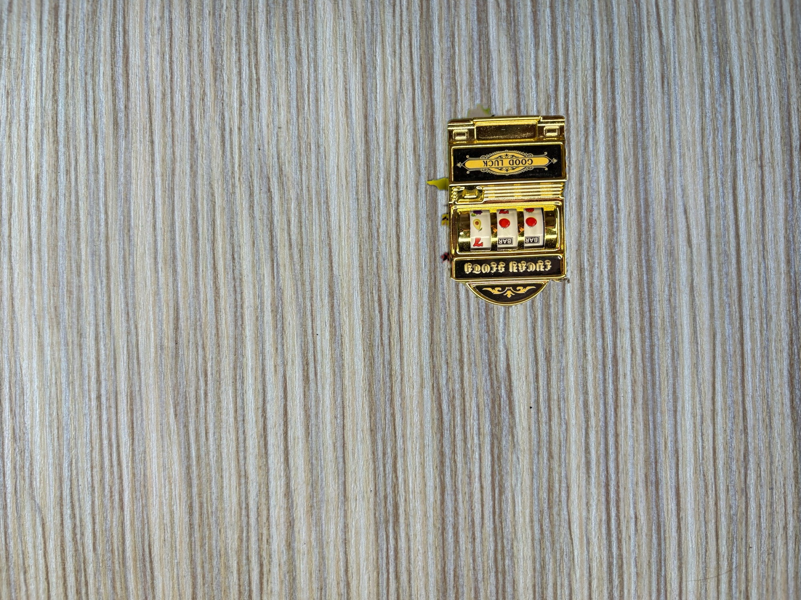
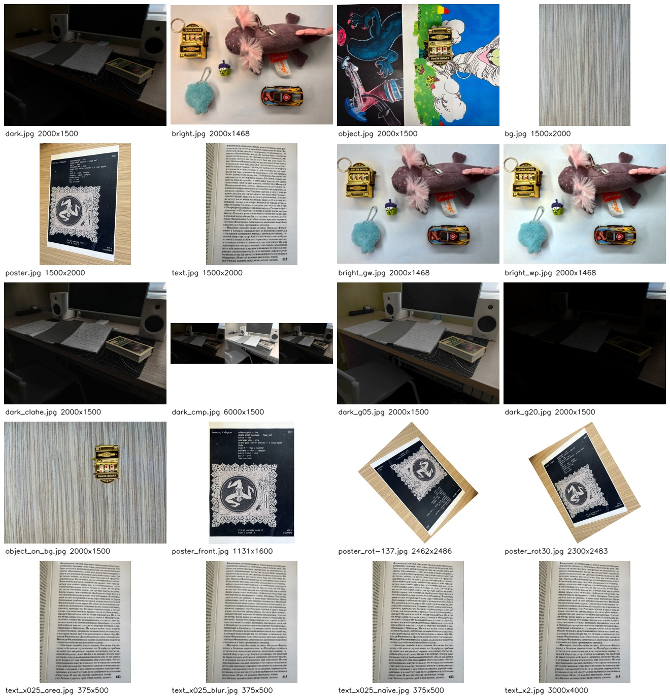

# ДЗ 1 «Фотолаборатория» — отчёт

**Автор:** Алексей Коваленко · **Группа:** B24-MFAI-02 · **Дата:** 11.10.2026

Реализованы 11 функций шаблона; все восемь CLI-команд выполнены на собственных фотографиях и проверены на кадрах курса. Основные результаты — в out/personal/, проверочные — в out/course/.

## 1. Числа

Источники: [свои измерения](out/personal/metrics.json), [JSON-строки CLI](out/personal/metrics.jsonl), [проверка на курсе](out/course/metrics.json).
Окружение: Python 3.11.9, opencv-contrib-python==4.14.0.94 (cv2 4.14.0), NumPy 2.4.6, Pillow 12.3.0. Статистика цвета и PSNR вычисляются по массивам до сохранения JPEG; маски и выпрямление для сравнения с эталоном — PNG без потерь. Яркости лежат в диапазоне 0–255; тройки каналов перечислены в порядке B, G, R.

### 1.1. Гамма — data/dark.jpg

Кадр: недоэкспонированный рабочий стол с тетрадями, книгой, монитором и колонками. Параметры: --gamma 0.5 и --gamma 2; гистограммы сохранены для обоих вариантов.

| γ | среднее | медиана | p1 | p99 | чёрных, % | белых, % |
|---|---------|---------|----|-----|-----------|----------|
| исходник | 19,0 | 6 | 0 | 177 | 10,49 | 0,00 |
| 0,5 | 53,2 | 38 | 0 | 213 | 10,31 | 0,00 |
| 2,0 | 4,8 | 0 | 0 | 123 | 58,83 | 0,00 |

Поля clipped_black_pct / clipped_white_pct шаблона считают пиксели серого кадра с уровнем 0 / 255, включая исходные крайние значения и округление; это не только пиксели, обрезанные операцией clip. Гамма 0,5 раскрывает тетради и стол, но не восстанавливает детали чёрного монитора, которых нет в исходнике.

### 1.2. Баланс белого — data/bright.jpg

Кадр: цветные игрушки и брелоки на белом листе под тёплым освещением. Параметры: --method grey-world и --method white-patch --percentile 99.

| Метод | усиление B / G / R | средние до | средние после |
|-------|--------------------|------------|---------------|
| grey-world | 1,121 / 1,013 / 0,892 | 133,7 / 147,9 / 168,5 | 149,8 / 150,0 / 150,3 |
| white-patch (p99) | 1,281 / 1,181 / 1,016 | 133,7 / 147,9 / 168,5 | 171,2 / 174,5 / 171,2 |

Средние всего кадра после grey-world почти равны, разброс 0,5. Однако равные средние сцены не гарантируют правильный цвет белого листа: розово-красные предметы смещают исходную статистику. Проверка участка бумаги x=800,y=1050,w=180,h=180 (координаты data/bright.jpg):

| Кадр | среднее B / G / R на белом листе | разброс каналов |
|------|--------------------------------|-----------------|
| исходный | 181,4 / 189,7 / 197,7 | 16,3 |
| grey-world | 203,3 / 192,5 / 176,4 | 26,9 |
| white-patch | 232,5 / 224,0 / 200,7 | 31,8 |

На этом участке оба метода переисправляют слабый тёплый оттенок в холодный; white-patch также осветляет кадр. Его p99 зависит от цветных бликов, а не от одного настоящего белого объекта. Для точной коррекции помогло бы вычисление коэффициентов по отдельной нейтральной карточке при том же освещении.

### 1.3. Глобальная эквализация и CLAHE — data/dark.jpg

Параметры: --clip 2 --tiles 8. Тени определены по исходному Lab L ≤ p20, света — L ≥ p80; для всех трёх кадров используются те же исходные области. «Света» здесь означают верхнюю пятую часть тёмного кадра, а не обязательно яркости около 255.

| Кадр | σ в тенях | среднее в тенях | среднее в светах |
|------|-----------|-----------------|------------------|
| исходный | 0,5 | 0,7 | 67,3 |
| equalizeHist | 33,7 | 52,4 | 226,0 |
| CLAHE | 1,9 | 4,7 | 101,1 |

Сравнение: [исходник / equalizeHist / CLAHE](out/personal/dark_cmp.jpg). Глобальная эквализация гораздо сильнее растягивает почти нулевые уровни и осветляет сцену; на мониторе появляются заметные полосы и неоднородности. CLAHE при clip=2 действует мягче и оставляет кадр довольно тёмным. Внутри Lab изменяется только L; при обратном переходе в BGR возможны малые изменения цвета из-за округления и ограничения цветового охвата.

### 1.4. Хромакей — data/object.jpg + data/bg.jpg

Объект — золотистый брелок с чёрными вставками на цветных рисунках; новый фон — деревянная поверхность. Цветовой образец: --sample 1160,400,150,18 на золотистой части корпуса. Открытие 5×5 и закрытие 9×9 с эллиптическими ядрами, крупнейшая компонента ≥200 px, заполнение замкнутых дыр, мягкий край σ=2.

| Что | Значение |
|-----|----------|
| lo / hi, HSV | (176,49,40) / (35,255,255) |
| площадь маски, px | 134506 |
| доля маски, % | 4,48 |
| компоненты до / после морфологии | 1697 / 111 |
| компоненты после выбора крупнейшей | 1 |
| дыры до / после заполнения | 27 / 0 |
| bbox x,y,w,h | 1065,259,359,509 |
| курс, ball-lamp.jpg: recall / precision, % | 94,60 / 99,91 |

Интервал H пересекает ноль: объединяются [176,179] и [0,35]. V открыт в пределах 40–255. Чёрные вставки внутри замкнутого золотого корпуса возвращены заполнением дыр; кольцо и некоторые наружные части потеряны, а похожий фон местами попал в маску — подробности в разделе 3.

### 1.5. Геометрия

| Что | Файл и параметры | Значение |
|-----|------------------|----------|
| поворот +30° | data/poster.jpg, --deg 30 | 1500×2000 → 2300×2483; пустой холст 47,5% |
| поворот −137° | data/poster.jpg, --deg -137 | 1500×2000 → 2462×2486; пустой холст 51,0% |
| уменьшение ×0,25 | data/text.jpg, --report | 375×500; PSNR naive / blur / area = 22,3 / 28,8 / 30,5 дБ |
| то же на здании курса | sample_data/iu-building.jpg, --report | 480×320; PSNR 27,9 / 36,0 / 37,2 дБ |
| увеличение ×2 | data/text.jpg, --scale 2 | 3000×4000; INTER_CUBIC |
| стороны листа в кадре | data/poster.jpg | top 1130,9; right 1914,8; bottom 1128,6; left 1496,4 px |
| реальные пропорции листа | A4, подтверждено автором | --aspect 210/297 = 0,707070707… |
| выпрямление своего листа | data/poster.jpg | 1131×1600; W/H=0,706875 |
| плакат курса к эталону | poster-angle.jpg, --size 640x905 | 99,10% совпадения после бинаризации |

Проверка формулы для собственного кадра при 30°:
W′ = 1500cos30° + 2000sin30° = 2299,0381;
H′ = 1500sin30° + 2000cos30° = 2482,0508.
Округление вверх даёт **2300×2483**; доля пустого холста вычисляется как 100*(1−W*H/(W′*H′)) по целочисленным размерам выхода. Границы всех пикселей сохраняются, что дополнительно проверено на −137° и точных четвертьоборотах. На здании курса результат 2303×2068 на один пиксель шире примера 2302×2068 из-за округления вверх вместо ближайшего целого.

Углы собственного листа переданы в произвольном порядке: 1222,1941,186,198,121,1693,1304,28. Упорядоченный результат TL,TR,BR,BL:
(186,198), (1304,28), (1222,1941), (121,1693). Aspect выбран по реальному A4, а не по длинам сторон в перспективе: видимые боковые стороны различаются на 418,4 px.

На тексте при ×0,25 теряются тонкие засечки: например, на «т» в слове «грусть» в участке x=1030,y=370,w=360,h=160 они перестают различаться как отдельные штрихи. У naive видны неровности и разрывы тонких линий, blur сглаживает их вместе с мелкими деталями, area даёт лучший из трёх PSNR, но также не сохраняет все засечки. Основные буквы остаются читаемы; полного исчезновения целого слова не наблюдалось. PSNR сравнивает с Lanczos и не заменяет оценку читаемости.

### 1.6. Контактный лист

Собственные фото и результаты: **N=20**, сетка **4×5**, ячейки 320×240, подписи 26 px, поля 8 px, лист **1320×1378**. Проверочный лист курса имеет те же N и размеры.

### 1.7. Дополнительная сверка на кадрах курса

| Проверка | Параметры | Измерение |
|----------|-----------|-----------|
| gamma, здание | γ=0,5 / 2 | среднее 134,6 → 174,3 / 95,0 |
| grey-world, ball-lamp | стандартный метод | усиления 0,999 / 1,028 / 0,975; средние после 61,3 / 61,2 / 61,2 |
| white-patch, ball-lamp | p99 | усиления 2,318 / 2,217 / 2,008; средние после 142,1 / 132,0 / 126,0 |
| equalizeHist / CLAHE, здание | clip=2, tiles=8 | σ теней: исходник 21,1; equalizeHist 14,8; CLAHE 32,3 |
| света, здание | те же параметры | средние 240,7 / 230,3 / 230,5 |
| ball-lamp | lo=(140,121,40), hi=(168,230,255) | площадь 9996 px; маска 1,63%; компоненты 1→1; дыр 0 |
| ball-day | sample=160,530,60,60 | lo=(140,88,40), hi=(166,228,255); площадь 10581; компоненты 11→1 |
| rectify, плакат | aspect=0,707 | 711×1006; стороны 698,7 / 791,0 / 710,6 / 511,6 px |

Эталон мяча: (x−190)²+(y−560)² ≤ 58². TP=9987, recall=TP/площадь эталона=94,60%, precision=TP/площадь маски=99,91%.
Маска: out/course/object_mask.png.
Эталон плаката: sample_data/poster-gt.png; совпадение с out/course/poster_front640.png вычислено после BGR2GRAY < 128.
RGB-равенство не используется, поскольку интерполяция и JPEG меняют уровни.

## 2. Три вопроса

### 2.1. Какое пространство выбрано для хромакея и почему? Что было бы в RGB?

Используется HSV: H и S задают цвет предмета, а V оставлен в диапазоне 40–255, чтобы освещённые участки и тени могли пройти один порог. На собственном брелоке интервал (176,49,40)–(35,255,255) даёт маску 4,48% кадра; на эталонном мяче recall=94,60%, precision=99,91%. В RGB освещение одновременно меняет три канала: тесный диапазон мог бы потерять тени, а широкий захватить похожий фон; отдельного измерения RGB здесь нет. HSV также ограничен: чёрные вставки и серебристое кольцо не имеют золотого оттенка, поэтому часть объекта не определяется одним цветовым интервалом.

### 2.2. Что происходит с гистограммой при γ < 1 и γ > 1? Куда деваются обрезанные пиксели?

При γ=0,5 гистограмма сдвигается вправо, тени растягиваются: среднее собственного кадра выросло с 19,0 до 53,2, медиана — с 6 до 38.
При γ=2 значения сдвигаются влево: среднее стало 4,8, медиана 0, доля чёрных пикселей выросла с 10,49% до 58,83%.
Положительная гамма сама сохраняет диапазон 0–255, но округление LUT объединяет близкие уровни; при других коррекциях clip прижимает выходящие за диапазон значения к 0/255, не удаляя пиксели. Различия внутри крайних уровней теряются: даже осветление исходника оставляет 10,31% чёрных пикселей и не возвращает не записанные камерой детали монитора.

### 2.3. Почему CLAHE лучше equalizeHist на своём фото — по числам?

На моём снимке CLAHE **не лучше по величине σ в тенях**: исходная σ=0,5, после equalizeHist=33,7, после CLAHE=1,9 при clip=2, tiles=8. Тени почти чёрные, поэтому глобальная эквализация резко растягивает немногие уровни, включая шум и ступени квантования; большой разброс не доказывает восстановления деталей. CLAHE изменяет светлые области мягче: среднее там 101,1 против 226,0 после equalizeHist и 67,3 до обработки, но оставляет снимок заметно тёмным. Для этого кадра нельзя утверждать безусловное преимущество CLAHE: методы дают разный компромисс между осветлением, локальным контрастом и артефактами.

## 3. Где сломалось

Команда chromakey data/object.jpg --bg data/bg.jpg --sample 1160,400,150,18 выделила корпус брелока, но потеряла серебристое кольцо, чёрный боковой рычаг и внешнюю тень; слева и сверху захвачены небольшие жёлто-зелёные участки рисунка. Это видно в out/personal/object_on_bg.jpg и object_mask.png. Причина: предмет неоднороден по цвету, а фон содержит оттенки, похожие на золото; порог HSV не различает принадлежность пикселя предмету по смыслу. Из 1697 исходных компонент морфология оставляет 111, затем выбирается одна, но это не устраняет фон, соединённый с корпусом. Заполнение 27 замкнутых дыр сохраняет внутренние чёрные вставки, но не восстанавливает кольцо и внешнюю тень. Для более чистого результата помогли бы одноцветный предмет, фон без близких оттенков или сегментация формы/ручное уточнение маски; простое расширение порога также увеличило бы захват фона.

## 4. Данные, команды и воспроизводимость

Для сдачи и повторения измерений используются шесть собственных фотографий в data/.

| JPEG | Размер, px | Размер файла, байт |
|------|------------|--------------------|
| dark.jpg | 2000×1500 | 257727 |
| bright.jpg | 2000×1468 | 506769 |
| object.jpg | 2000×1500 | 815218 |
| bg.jpg | 1500×2000 | 1330514 |
| poster.jpg | 1500×2000 | 1103199 |
| text.jpg | 1500×2000 | 1093478 |

Все JPEG соответствуют ограничениям ≤2000 px и ≤1,5 МБ.

~~~bash
python -m pip install -r requirements.txt
python -m pytest tests -q
python run_experiments.py --dataset course
python run_experiments.py --dataset personal --sample 1160,400,150,18 --corners 1222,1941,186,198,121,1693,1304,28 --aspect 0.7070707070707071
~~~

Эти два прогона повторяют все изображения в out/course/ и out/personal/, а также сохраняют JSON с измерениями и полные списки отдельных команд:
[course/commands.txt](out/course/commands.txt) и
[personal/commands.txt](out/personal/commands.txt).
Координаты относятся к фотографиям из data/. Изображения курса включены в sample_data/. Recall, precision, совпадение эталона и проверка белого участка вычисляются в run_experiments.py; формулы и координаты приведены выше.

## 5. Инструменты и проверка

За основу взяты CLI, ввод-вывод, метрики, исходные тесты и CI из template/ этого задания. Реализация функций, дополнительные проверки, скрипты и отчёт были написаны самостоятельно с использованием OpenAI ChatGPT как ассистента-помощника. Фото были сделаны вручную; результаты получены вычислениями, без генерации изображений. Для обработки использованы разрешённые операции OpenCV и NumPy, для эталона Lanczos — Pillow. LUT, баланс белого, расчёт холста, порядок углов, размер выпрямления и раскладка
листа реализованы явно.
